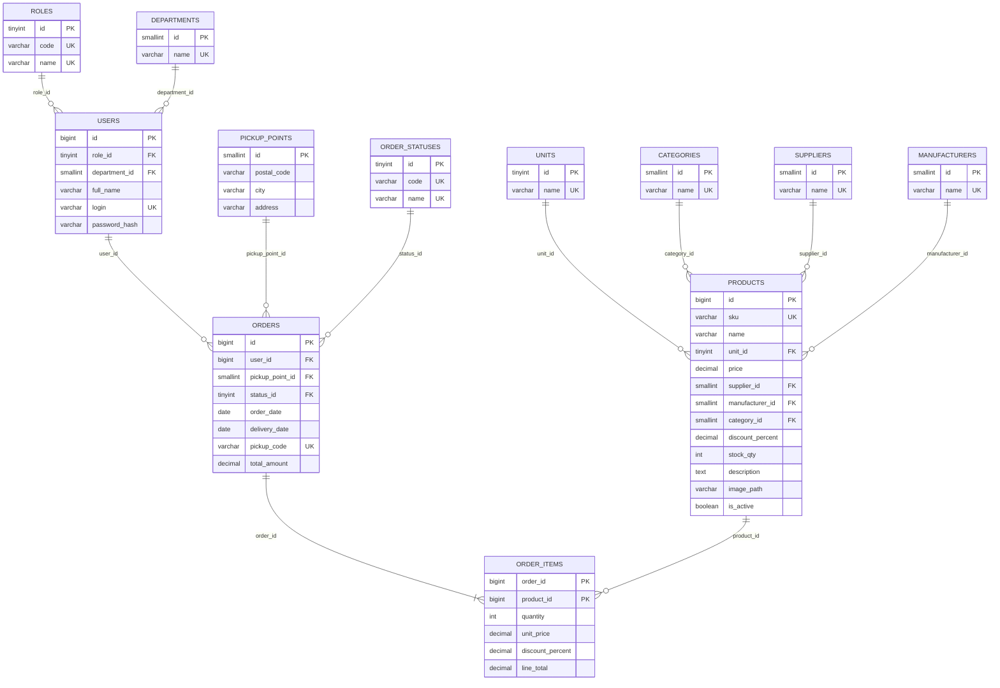

# Проектирование базы данных

## 1. Принципы

1. **3НФ для предметной области.** Поставщики, производители, категории, единицы измерения, роли, отделы и статусы — отдельные справочники, а не текстовые поля.
2. **Снимки цен.** В `order_items` хранятся `unit_price` и `discount_percent` на момент заказа: изменение цены товара не переписывает историю.
3. **Суррогатные PK + бизнес-ключи.** `id BIGINT` для связей, `sku` и `login` — уникальные бизнес-ключи.
4. **Целостность на уровне БД.** FK, `CHECK`, `NOT NULL`, `DECIMAL` для денег, `utf8mb4` для русского текста.
5. **Мягкое удаление товара.** `is_active = 0` сохраняет ссылки из `order_items`.
6. **Минимум сущностей.** Нет audit-логов, сессий, складских движений и прочего, чего нет в заданиях.

## 2. ER-диаграмма



Связь «заказ — товар» реализована как N:M через `order_items` с атрибутами количества и снимка цены. Всего 12 таблиц.

## 3. Назначение таблиц

| Таблица | Назначение | Ключевые ограничения |
|---|---|---|
| `roles` | Роли из задания 4 | `code`, `name` уникальны |
| `departments` | Отделы из задания 4 | `name` уникален |
| `users` | Пользователи заданий 2–4 | `login` уникален, `password_hash` — bcrypt |
| `units`, `categories`, `suppliers`, `manufacturers` | Справочники товара | `name` уникален |
| `products` | Товары | `sku` уникален, `price >= 0`, скидка 0–100 |
| `pickup_points` | 36 пунктов выдачи | `(postal_code, address)` уникальна |
| `order_statuses` | «Новый», «Завершен» | `code`, `name` уникальны |
| `orders` | Заказы | `pickup_code` уникален, даты согласованы |
| `order_items` | Позиции заказа | PK `(order_id, product_id)`, `quantity > 0` |

## 4. Индексы и запросы

| Таблица | Индекс | Обслуживает |
|---|---|---|
| `users` | `uq_users_login` | Вход по логину, проверка уникальности |
| `users` | `idx_users_role_dept_name` | Фильтр «роль + отдел» + сортировка по ФИО |
| `users` | `idx_users_dept_name` | Фильтр только по отделу + сортировка |
| `users` | `idx_users_full_name` | Сортировка и поиск по префиксу |
| `products` | `uq_products_sku` | Поиск по артикулу, защита от дублей |
| `products` | `idx_products_category` | Категория + активность + цена |
| `products` | `idx_products_supplier` | Поставщик + активность + цена |
| `products` | `idx_products_manufacturer` | Производитель + активность + цена |
| `products` | `idx_products_active_price` | Каталог без фильтров, сортировка по цене |
| `products` | `idx_products_active_stock` | Сортировка по остатку |
| `products` | `idx_products_name` | Поиск по префиксу названия |
| `orders` | `idx_orders_user_date` | Заказы пользователя по дате |
| `orders` | `idx_orders_status_date` | Составной индекс `(status_id, order_date)` |
| `orders` | `idx_orders_date` | Диапазон дат без статуса |
| `orders` | `idx_orders_pickup` | JOIN с пунктом выдачи, FK |
| `order_items` | `idx_order_items_product` | Обратный поиск «где используется товар», FK |

Примеры запросов:

```sql
-- Поиск по ФИО (10 строк — seq scan оптимальнее индекса)
SELECT id, full_name, login
FROM users
WHERE full_name LIKE CONCAT('%', ?, '%')
ORDER BY full_name;

-- Фильтр по роли и отделу + сортировка
SELECT u.id, u.full_name, u.login, r.name, d.name
FROM users u
JOIN roles r ON r.id = u.role_id
LEFT JOIN departments d ON d.id = u.department_id
WHERE u.role_id = ? AND u.department_id = ?
ORDER BY u.full_name;

-- Каталог: фильтр по категории + сортировка по цене
SELECT id, sku, name, price, discount_percent, stock_qty
FROM products
WHERE is_active = 1 AND category_id = ?
ORDER BY price;

-- Заказы: список по дате
SELECT id, user_id, order_date, delivery_date, total_amount
FROM orders
ORDER BY order_date DESC, id DESC
LIMIT 200;
```

Значения передаются через параметры `@name`. Поле и направление сортировки выбираются в коде из белого списка (`name`, `price`, `stock_qty`), в SQL не подставляются данные пользователя.

**Поиск по ФИО.** На 10 пользователях `LIKE '%…%'` — правильный выбор: индекс не используется, но таблица крошечная. При росте до тысяч строк нужен `FULLTEXT` или отдельная таблица поиска; это точка масштабирования, а не преждевременная оптимизация. Спецсимволы `%`, `_` и `\` экранируются перед подстановкой.

## 5. Транзакции и блокировки

Создание/редактирование заказа:

```sql
START TRANSACTION;

-- total_amount рассчитан из позиций до вставки
INSERT INTO orders (user_id, pickup_point_id, status_id, order_date,
                    delivery_date, pickup_code, total_amount)
VALUES (?, ?, ?, ?, ?, ?, ?);

-- Позиции уникальны по product_id (проверка DUPLICATE_ITEM)
INSERT INTO order_items (order_id, product_id, quantity,
                         unit_price, discount_percent, line_total)
VALUES (?, ?, ?, ?, ?, ?);

COMMIT;
```

Правила:

1. Одна короткая транзакция на заказ; внутри нет обращений к другим системам.
2. Позиции уникальны по `product_id` (проверка `DUPLICATE_ITEM`), PK `(order_id, product_id)` — последний рубеж против дублей.
3. При любой ошибке выполняется `ROLLBACK`, частично записанный заказ не остаётся в базе.
4. Изменение заказа заменяет позиции: старые строки удаляются и вставляются новые в той же транзакции.
5. Остатки склада заказами не изменяются: в исходных данных `stock_qty` — независимый атрибут, а заказы исторические. Это исключает самый конфликтный сценарий блокировок.
6. Приложение одно, операции над одним заказом не пересекаются; порядок блокировок одинаковый (`orders`, затем `order_items`), поэтому дедлоки не возникают. Повторных попыток в коде нет: при ошибке пользователь видит сообщение и повторяет действие.

## 6. Аутентификация

| Параметр | Значение |
|---|---|
| Хеш пароля | bcrypt, cost 12 |
| Проверка входа | `AuthService`: `users JOIN roles LEFT JOIN departments`, затем `BCrypt.Verify` |
| Неизвестный логин | Проверка по фиктивному хешу, чтобы время ответа не выдавало наличие логина |
| Состояние входа | `UserInfo` в памяти приложения на время сеанса |
| Открытый пароль | Не сохраняется |
| Повторный вход | При каждом запуске приложения |

Пароли из Excel (6 символов) хешируются при подготовке данных; открытый текст нигде не хранится. Сессии и токены не нужны: приложение настольное, доступ к базе закрыт учётной записью MySQL.

## 7. Подготовка данных из Excel

| Источник | Целевые поля | Правила |
|---|---|---|
| `user_import.xlsx` | `users.full_name`, `login`, `password_hash`, `role_id`, `department_id` | `login` → trim; пароль → bcrypt 12; роль по названию; отдел: администраторы → «Администрация», менеджеры → «Отдел продаж», клиенты → NULL |
| `Tovar.xlsx` | `products.*` | Артикул → латиница/верхний регистр; справочники создаются из уникальных значений; пустое фото → NULL |
| `Пункты выдачи_import.xlsx` | `pickup_points` | Номер строки (1-based) → `id`; город и адрес нормализуются |
| `Заказ_import.xlsx` | `orders`, `order_items` | Пары «артикул, количество»; Excel serial → дата; `30.02.2025` → `2025-02-28` + предупреждение; `total_amount` = сумма строк |
| Связь заказа с клиентом | `orders.user_id` | По точному ФИО; при дублях приоритет роли «клиент» и предупреждение; при 0 совпадений — ошибка |

Конвертация даты Excel: `1899-12-30 + N дней`.

Данные перенесены один раз при подготовке дампа. Повторная загрузка выполняется восстановлением `db/dump/shoe_store.sql`: скрипт пересоздаёт таблицы и заново наполняет их, поэтому дубли не появляются. Отдельного импортёра в приложении нет — он не требуется заданиями.

## 8. Соответствие заданиям

| Задание | Таблицы |
|---|---|
| 1. ER по Excel | `users`, `products`, справочники, `pickup_points`, `orders`, `order_items`, `order_statuses` |
| 2. Пользователи без ролей, поиск по ФИО | `users` (на этапе 2 — только ФИО и логин) |
| 3. Аутентификация | `users.login`, `users.password_hash` |
| 4. Роли, отделы, фильтры | `roles`, `departments`, `users.role_id`, `users.department_id` |

Итоговая схема — надмножество всех этапов: промежуточное состояние задания 2 достигается выборкой без колонок роли и отдела, финальное состояние задания 4 — полной моделью.

## 9. Файлы

- `db/001_schema.sql` — таблицы, индексы, ограничения.
- `db/002_seed_reference.sql` — роли, отделы, статусы, единица измерения, 36 пунктов выдачи.
- `db/dump/shoe_store.sql` — полный дамп рабочей базы (схема и данные).
