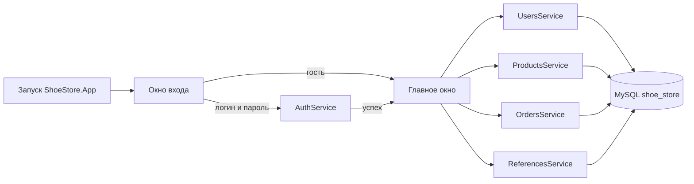

# Архитектура приложения и экранные формы

## 1. Схема решения



Приложение состоит из трёх проектов:

| Проект | Содержимое |
|---|---|
| `ShoeStore.Core` | Модели, `Database`, `AuthService`, сервисы, `RolePermissions`, утилиты `Sku` и `SqlHelpers` |
| `ShoeStore.App` | WPF-окна, обработчики событий, загрузка данных в таблицы |
| `ShoeStore.Tests` | xUnit-тесты модулей и интеграционные проверки на MySQL |

Логика работы с базой находится в Core и не зависит от WPF. Окна вызывают сервисы и показывают результат.

## 2. Запуск

1. `App.OnStartup` задаёт культуру `ru-RU` и читает строку подключения из `appsettings.json`.
2. Создаётся `Database`, затем открывается `LoginWindow` как модальное окно.
3. Если пользователь закрыл окно входа или отказался входить, приложение завершается.
4. После успешного входа создаётся `MainWindow` с объектом `UserInfo` и сервисами.
5. При ошибке подключения показывается сообщение и приложение закрывается.

`ShutdownMode` до показа главного окна — `OnExplicitShutdown`, после — `OnMainWindowClose`. Поэтому отмена входа не оставляет процесс висеть.

## 3. Окно входа

| Элемент | Поведение |
|---|---|
| Поле «Логин» | Обязательное, пробелы по краям отбрасываются |
| Поле «Пароль» | Обязательное, ввод скрыт |
| Кнопка «Войти» | Проверяет пару через `AuthService`; при ошибке показывает текст под полями |
| Кнопка «Продолжить как гость» | Открывает главное окно с `CurrentUser = null` |

При неверных данных выводится одно сообщение «Неверный логин или пароль» — без указания, что именно неверно. Пока идёт проверка, кнопка входа блокируется.

## 4. Главное окно

Сверху — название системы и подпись текущего пользователя: ФИО, роль, отдел. Для гостя — «Гость». Ниже — вкладки:

| Вкладка | Кому видна | Содержимое |
|---|---|---|
| «Пользователи» | Клиент, менеджер, администратор | Поиск по ФИО, фильтры «Роль» и «Отдел», таблица ФИО / Логин / Роль / Отдел |
| «Товары» | Все | Каталог; фильтры и сортировка — менеджеру и администратору; кнопки изменения — администратору |
| «Заказы» | Менеджер, администратор | Список заказов и состав выбранного заказа; кнопки изменения — администратору |

Гость не видит вкладку пользователей, и при запуске сразу открывается вкладка «Товары». Если вкладка скрыта, она не остаётся выбранной.

### Пользователи

Поиск выполняется по подстроке ФИО без учёта регистра. Фильтры по роли и отделу применяются вместе с поиском. Пустое значение ComboBox означает «все». Список отсортирован по ФИО.

### Товары

| Фильтр | Значение |
|---|---|
| Поиск | Наименование или артикул |
| Категория, поставщик, производитель | Значение из справочника |
| «Только со скидкой» | Скидка больше нуля |
| Сортировка | Название А–Я и Я–А, цена по возрастанию и убыванию, скидка, остаток |

Показываются только активные товары. В таблице: артикул, наименование, категория, поставщик, производитель, цена, скидка, итоговая цена, остаток. Итоговая цена считается как `price × (1 − discount / 100)` с округлением до копеек.

### Заказы

Сверху список заказов: номер, даты, статус, клиент, пункт выдачи, сумма, число позиций. Ниже — состав выбранного заказа: артикул, наименование, количество, цена, скидка, сумма строки. Менеджеру доступен только просмотр.

### Оформление

Все стили собраны в `App.xaml`: палитра, типографика, карточки, кнопки, поля ввода, таблицы, вкладки и календарь. Тёмная верхняя панель, медный акцент `#B45309`, светлый фон `#F6F4EF`, карточки с радиусом 14 и заголовки Bahnschrift. Иконки — шрифт Segoe MDL2 Assets. Строка состояния показывает количество записей активной вкладки.

## 5. Форма товара

Поля: артикул, наименование, категория, поставщик, производитель, единица измерения, цена, скидка, остаток, описание.

Проверки:

- артикул приводится к верхнему регистру, кириллические омоглифы заменяются латиницей; допустимы 4–32 символа `A–Z0–9`;
- наименование не пустое;
- цена не отрицательная, скидка от 0 до 100, остаток целый и не отрицательный;
- справочники обязательны.

Ошибка показывается в форме, диалог не закрывается. Удаление товара переводит `is_active` в 0, поэтому история заказов сохраняется.

## 6. Форма заказа

Поля: клиент, статус, пункт выдачи, дата заказа, дата выдачи, код выдачи, строки товаров.

| Проверка | Результат |
|---|---|
| Клиент, статус, пункт выдачи выбраны | Иначе сообщение об ошибке |
| Дата выдачи не раньше даты заказа | Иначе ошибка |
| Код выдачи не пустой и уникальный | Дубли отклоняются |
| В заказе есть позиции | Пустой заказ не сохраняется |
| Товар не повторяется | Проверка перед записью |
| Количество больше нуля | Иначе ошибка |

Сумма строки и итог заказа пересчитываются на сервере по текущей цене и скидке товара. Запись заказа и позиций выполняется в одной транзакции: при ошибке изменения откатываются.

## 7. Права ролей

```csharp
public static bool CanUseProductFilters(string? roleCode) =>
    roleCode is Role.AdminCode or Role.ManagerCode;

public static bool CanManageProducts(string? roleCode) =>
    roleCode is Role.AdminCode;

public static bool CanViewOrders(string? roleCode) =>
    roleCode is Role.AdminCode or Role.ManagerCode;

public static bool CanManageOrders(string? roleCode) =>
    roleCode is Role.AdminCode;
```

Окно применяет эти проверки один раз при создании: скрывает вкладки, панель фильтров и кнопки. Для гостя дополнительно выбирается вкладка «Товары». Клиент не получает доступ к заказам, менеджер — к изменению данных.

## 8. Работа с базой

- `Database.Open()` создаёт новое подключение MySqlConnector на операцию.
- Все значения передаются через `AddWithValue`, SQL-инъекция невозможна.
- Для `LIKE` спецсимволы экранируются методом `SqlHelpers.LikeContains`.
- Поле сортировки транслируется в фиксированный фрагмент SQL по `switch`, произвольная строка в запрос не попадает.
- Деньги считаются в `decimal`, округление — `MidpointRounding.AwayFromZero`.
- Чтение nullable-полей идёт через `ReaderExtensions`, чтобы не путать `NULL` с нулём.

## 9. Ошибки и потоки

Длительные операции выполняются в `Task.Run`, результат возвращается в UI-поток. Доменные ошибки (`DomainException`) показываются текстом в форме или сообщением. Необработанные ошибки запуска показываются в окне «Ошибка запуска».

## 10. Ограничения

- Автотестов интерфейса нет: WPF проверялся вручную по сценариям из `docs/04-test-report.md`.
- Приложение рассчитано на одного пользователя за рабочей станцией; конкурентная работа с одним заказом не поддерживается.
- Изображения товаров в архив заданий не входят, поэтому поле `image_path` пустое и фото не отображается.
