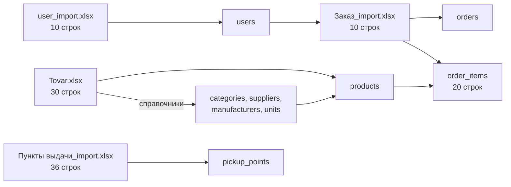

# Отчёт о переносе данных из Excel в MySQL

**Источник:** Excel-файлы задания 1 — `user_import.xlsx`, `Tovar.xlsx`, `Заказ_import.xlsx`, `Пункты выдачи_import.xlsx`
**База:** `shoe_store`, MySQL 8.0.46, `utf8mb4`
**Дата переноса:** 31.10.2026
**Результат:** полный дамп `db/dump/shoe_store.sql`

## 1. Итоговые показатели

| Показатель | Значение |
|---|---:|
| Пользователи | 10 |
| — администраторы | 3 |
| — менеджеры | 3 |
| — авторизированные клиенты | 4 |
| Товары | 30 |
| Категории | 2 |
| Поставщики | 2 |
| Производители | 6 |
| Единицы измерения | 1 |
| Пункты выдачи | 36 |
| Статусы заказов | 2 |
| Заказы | 10 |
| Позиции заказов | 20 |
| Сумма заказов | 290 337,56 ₽ |
| Товары без фото | 20 |
| Товары с нулевым остатком | 2 |
| Неактивные товары | 0 |



## 2. Как получены данные

Excel-файлы прочитаны один раз, значения приведены к правилам раздела 3 и записаны в MySQL. Отдельного импортёра в приложении нет: заданиям он не нужен, а результат переноса уже зафиксирован в дампе.

Восстановление дампа в MySQL Workbench пересоздаёт таблицы и заново загружает те же строки. Поэтому повторный запуск скрипта не задваивает заказы и товары. Схема `shoe_store` создаётся скриптом; другие схемы, включая `konstruktor_zanyatiy`, не затрагиваются.

## 3. Правила преобразования

### 3.1. Пользователи

| Колонка Excel | Поле БД | Правило |
|---|---|---|
| Роль | `role_id` | Сопоставление по названию: Администратор, Менеджер, Авторизированный клиент |
| ФИО | `full_name` | Повторные пробелы схлопываются |
| Логин | `login` | Обязателен, уникален |
| Пароль | `password_hash` | bcrypt, cost 12; открытый пароль не сохраняется |

Отдел назначается по роли: администратор → «Администрация», менеджер → «Отдел продаж», клиент → `NULL`. В справочнике отделов также есть «Склад» и «Бухгалтерия» — они доступны в фильтре, но пользователей из Excel в них нет.

### 3.2. Товары

| Правило | Описание |
|---|---|
| Артикул | `NFC`, обрезка, верхний регистр, кириллические омоглифы → латиница (`А→A`, `В→B`, `С→C`, `Е→E`, `Т→T` и т.д.) |
| Допустимый артикул | `^[A-Z0-9]{4,32}$` |
| Цена | Запятая → точка, пробелы удаляются; проверка `≥ 0` |
| Скидка | 0–100 % |
| Остаток | Целое `≥ 0` |
| Единица | По умолчанию «шт.» |
| Справочники | Создаются из уникальных значений файла, повторно не дублируются |

### 3.3. Заказы

| Правило | Описание |
|---|---|
| Номер заказа | Берётся из Excel, сохраняется как `orders.id` |
| Список товаров | Формат `АРТИКУЛ, КОЛИЧЕСТВО, АРТИКУЛ, КОЛИЧЕСТВО, ...` |
| Владелец | Поиск по ФИО; при дублях приоритет у роли «клиент» |
| Статус | Сопоставление по названию без учёта регистра |
| Пункт выдачи | Номер строки файла (1-based), всего 36 пунктов |
| Суммы | `line_total = qty × price × (1 − discount / 100)`, итог — сумма строк, округление до копеек |

### 3.4. Пункты выдачи

| Правило | Описание |
|---|---|
| Идентификатор | Номер строки (1-based), от 1 до 36 |
| Индекс | Сохраняется как строка |
| Город | Приводится к единому написанию |
| Адрес | Сохраняется как в источнике; у пункта №19 номера дома нет |

## 4. Аномалии исходных данных

| Аномалия | Где | Было | Стало | Причина |
|---|---|---|---|---|
| Кириллица в артикуле | `Tovar.xlsx` | `А112Т4` | `A112T4` | Омоглифы `А` и `Т` |
| Несуществующая дата | `Заказ_import.xlsx`, строка 8 | `30.02.2025` | `2025-02-28` | В феврале 2025 нет 30-го числа |
| Дубли ФИО | `user_import.xlsx` | Ворсин П.Е., Старикова Е.П. по два раза | — | Разные учётные записи; уникален только логин |
| Нет фото | `Tovar.xlsx` | 20 товаров | `image_path = NULL` | В Excel пустое поле |
| Нулевой остаток | `Tovar.xlsx` | 2 товара | `stock_qty = 0` | Данные Excel |
| Нет номера дома | `Пункты выдачи_import.xlsx`, №19 | Адрес без дома | Адрес сохранён | Данные Excel |
| Изображения отсутствуют | Архив заданий | `1.jpg…10.jpg` | Фото не задано | Файлов нет в архиве |

## 5. Проверка результата

```sql
USE shoe_store;

SELECT COUNT(*) FROM users;         -- 10
SELECT COUNT(*) FROM products;      -- 30
SELECT COUNT(*) FROM pickup_points; -- 36
SELECT COUNT(*) FROM orders;        -- 10
SELECT COUNT(*) FROM order_items;   -- 20
SELECT SUM(total_amount) FROM orders; -- 290337.56
```

Дополнительно проверяется, что для каждого заказа `total_amount` равен сумме `order_items.line_total`. Проверка выполняется автоматически в интеграционных тестах и вручную после восстановления дампа.

## 6. Повторная загрузка

| Сценарий | Действие |
|---|---|
| Вернуть исходные данные | Выполнить `db/dump/shoe_store.sql` в MySQL Workbench |
| Создать схему без данных | Выполнить `db/001_schema.sql`, затем `db/002_seed_reference.sql` |
| Изменить данные вручную | Работать в приложении под администратором |

Дамп содержит только предметные данные: пользователей, справочники, товары, пункты выдачи и заказы. Служебных сессий и временных записей в нём нет.
